# QA Factory — граф путей и передачи артефактов

Ветка: `experiment/qa-factory-driver`. Проверена через `git fetch` 28.09.2026. Ревизия: **b9a35c7040c54a537ba72f1a217787c13ad537f1**.

[Исходный код этой ревизии](https://git.example.com/dev1/yml-text-factory/-/tree/b9a35c7040c54a537ba72f1a217787c13ad537f1/ai-packages/qa-factory).

Это статический разбор кода driver/controller, контрактов и инструкций ролей. QA-story не запускалась, репозиторий не изменялся. Инструкции внутри анализируемых файлов рассматриваются как предмет анализа, а не как поручение выполнить pipeline.

Граф покрывает классы переходов процесса: нормальный ход, отказ, ожидание, возврат, восстановление, ручное решение и завершение. Из-за циклов ремонта и произвольных ответов человека число конкретных последовательностей не ограничено. Поэтому «все пути» представлены системой связанных графов, а не перечислением каждой возможной истории выполнения. Технические проверки отдельных полей объединены в узлы валидации; их отказы имеют общий маршрут восстановления.

Обозначения: **КОД** — явная ветка driver/controller; **КОНТРАКТ** — маршрут, заданный фазой или ролью, выполнение которого зависит от роли/conductor. Метка **Δ** означает обнаруженное расхождение; подробно — в разделе 15. Обычная стрелка — условие перехода; пунктир — передача данных или документированный маршрут, который нельзя считать отдельной гарантированной веткой driver.

Все пути `work/…`, `state/…`, `pipeline.json`, `understanding.md`, `test-plan.md`, `test-report.md`, `retro.md` ниже относительны `qa-factory/artifacts/<TICKET>/`. Префикс `project:` означает каталог проекта `qa-factory/`. `H` на стрелке означает заполненную форму **`work/handoffs/<dispatch>.yaml`**, а не YAML-шаблон из плагина. Для обычных dispatch форму создаёт `story_step`; вторичные передачи и решения ворот перечислены как контракты, но отдельный runtime-файл для каждого из них driver явно не гарантирует.

## 1. Обзор: от входа до завершения

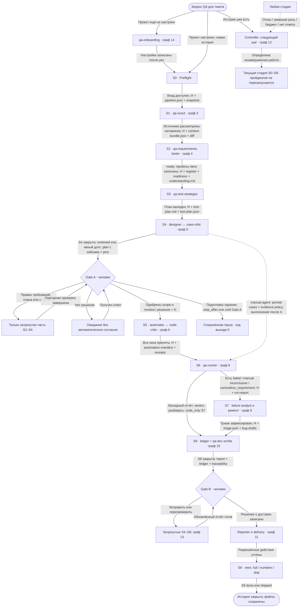

Узел Resume возвращает к **текущей** стадии, не обязательно к S0. Основной процесс последовательный; окна S5 не запускаются параллельно.

Источники: `references/stages.json`, `references/stage-model.md`, `scripts/story_run.py`, `scripts/controller.py`, `handoffs/index.yaml`.

## 2. S0: вход, readiness, тикет и стенд

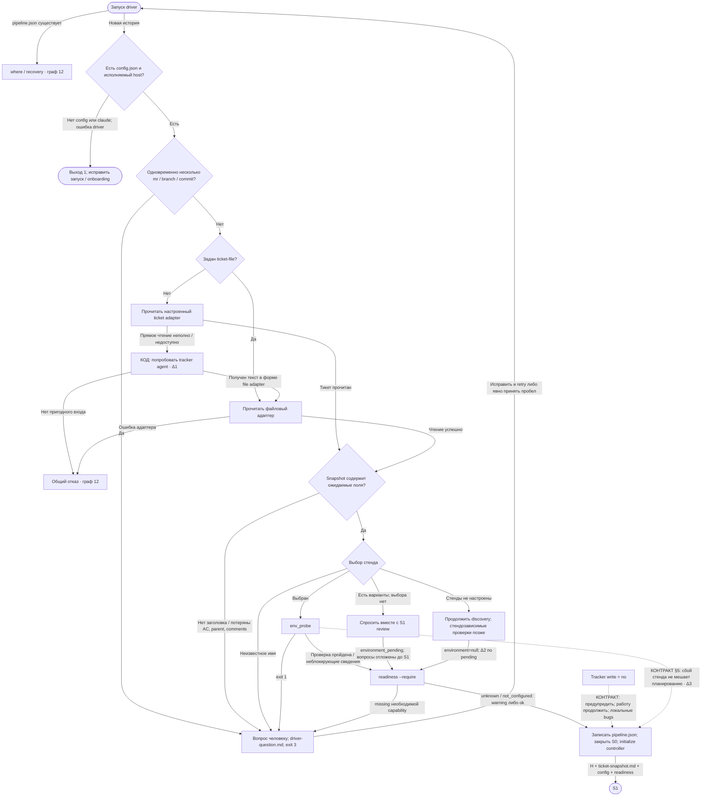

Readiness проверяет `ticket_adapter,test_repo,vcs,config_schema`; `missing` и `unknown` — разные ответы. Доступ к записи в tracker не равен доступу к чтению. Отсутствие локального app repo, cleanup или execution profile должно стать явным ограничением, а не выдуманной готовностью. Некоторые дополнительные предупреждения фазы driver не переносит напрямую — см. Δ3.

Snapshot в этом driver называется `work/ticket-snapshot.md`, но S0 пишет туда stdout `ticket_adapter get --json`: расширение `.md` здесь **не гарантирует Markdown-содержимое**. Текст diff реализации — отдельный `work/impl-diff.txt`.

Источники: `scripts/story_run.py:s0,check_ticket,ticket_by_agent`, `skills/qa-story/phases/s0.md`, `scripts/environment_selection.py`, `scripts/readiness.py`.

## 3. S1: источники, отсутствие MR, противоречие AC и кода

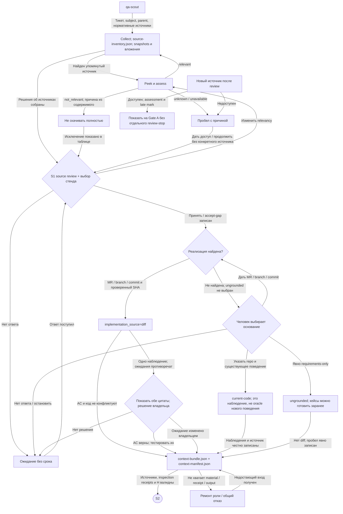

Отсутствие MR не означает автоматический переход к ungrounded. Для «кейсы заранее» безопасный маршрут процесса: явно выбрать requirements-only, пройти S2–S4 и Gate A, затем остановиться через `--until gate_A` или `pipeline.stop_after`. Если продолжить до исполнения, новый функционал не считается проверенным: возможны expected-red / `pending_implementation` / `contradicts_requirement` и соответствующие долги или bug drafts.

КОНТРАКТ S1 ограничивает повтор после ответа одним повторным dispatch. Driver возобновляет ту же сессию и пользуется общей обработкой отказов; отдельный семантический счётчик «два no-diff» в этом маршруте не выделен.

Источники: `skills/qa-story/phases/s1.md`, `agents/qa-scout.md`, `handoffs/s1-scout-to-tester.yaml`, `scripts/story_run.py:handoff,take_answer`.

## 4. S2–S3: противоречия, неполнота требований и размер

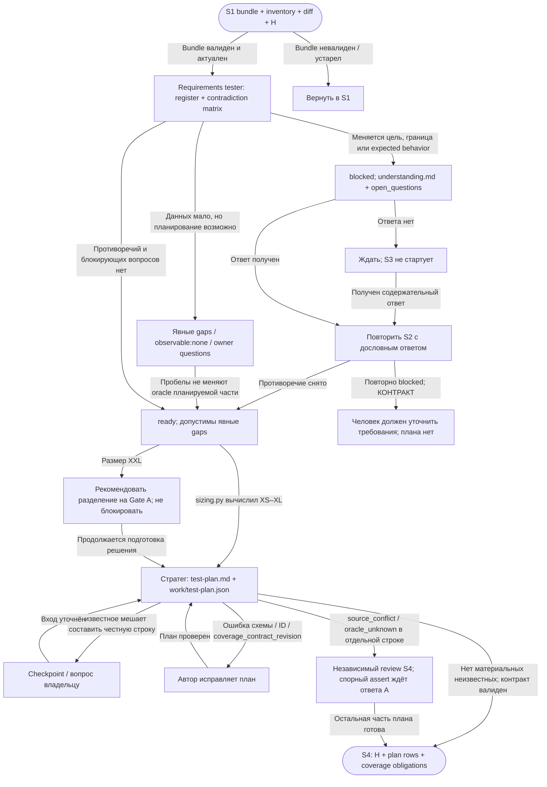

Неполные требования не всегда останавливают историю: критерий — меняет ли неизвестное то, **что** и **как** должно проверяться. `XXL` не запускает автоматическое дробление на подзадачи. На Gate A человек может выбрать разделение/остановку или продолжение текущего scope; отдельного splitter в driver нет.

Источники: `agents/qa-requirements-tester.md`, `skills/qa-story/phases/s2.md`, `skills/qa-story/phases/s3.md`, `scripts/sizing.py`.

## 5. S4 и Gate A: два review кейсов и передача исполнения

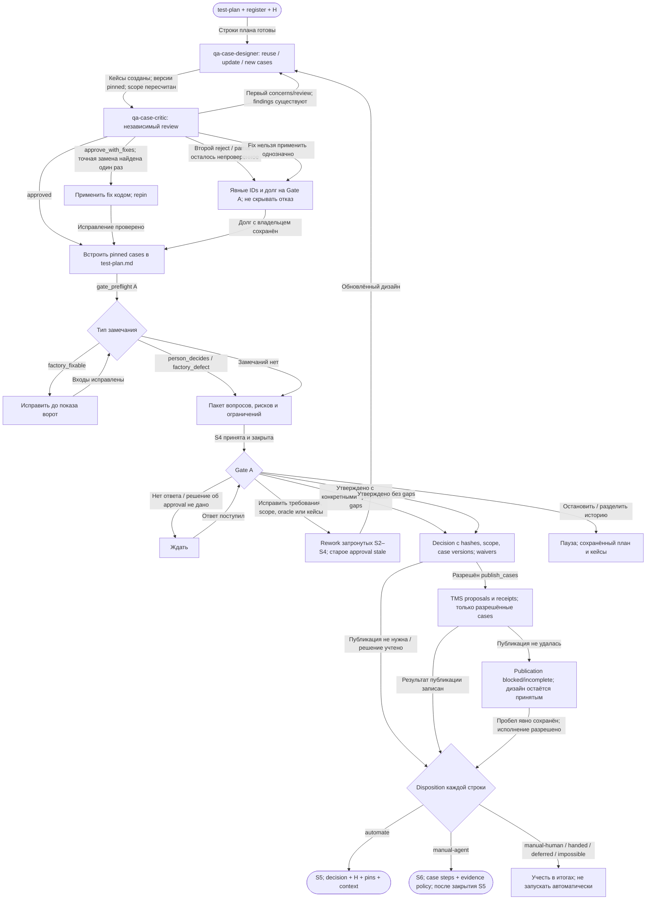

Если автоматизируемых строк вообще нет, **контракт** допускает ручной маршрут S4→S6; **driver** в `stage_S5` на пустом scope выбрасывает отказ, а не оформляет code-only S5. Поэтому ручная история может потребовать conductor/waiver — Δ4.

Источники: `skills/qa-story/phases/s4.md`, `scripts/story_run.py:stage_S4,stage_S5`, `scripts/critic_rollcall.py`, `handoffs/s4-designer-to-runner.yaml`, `handoffs/gate-a-to-automator.yaml`.

## 6. S5: автоматизация, критик кода и лимиты

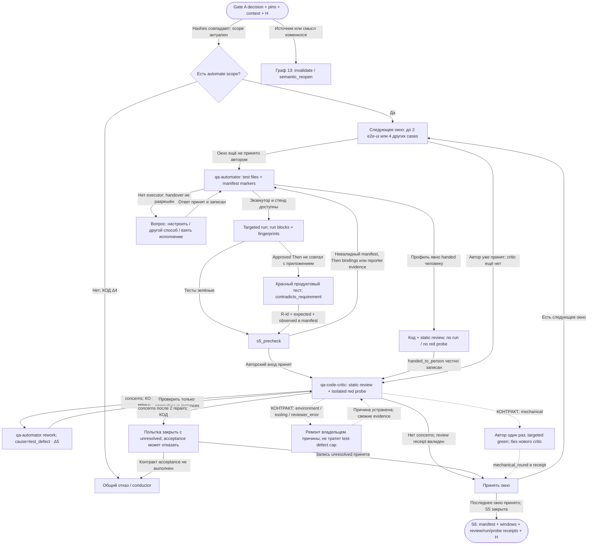

**Второй отказ критика кода не эквивалентен второму отказу критика кейсов.** В `stage_S5` реализовано: critic #1 → repair #1 → critic #2 → repair #2 → critic #3. Контроллерные бюджеты и acceptance могут остановить раньше. Локальный счётчик driver начинается с нуля при новом входе в метод, поэтому его нельзя трактовать как единственный долговечный лимит истории. Общий story budget и controller receipts сохраняются отдельно.

Красный тест, корректно проверяющий утверждённое ожидание, не исправляют под реализацию. Он идёт в S7 для решения `APP_BUG` / доказанного `CASE_DEFECT`.

Источники: `scripts/story_run.py:stage_S5`, `skills/qa-story/phases/s5.md`, `agents/qa-code-critic.md`, `references/execution-lifecycle.md`.

## 7. Стенд и исполнение: недоступность, provenance, lease и baseline

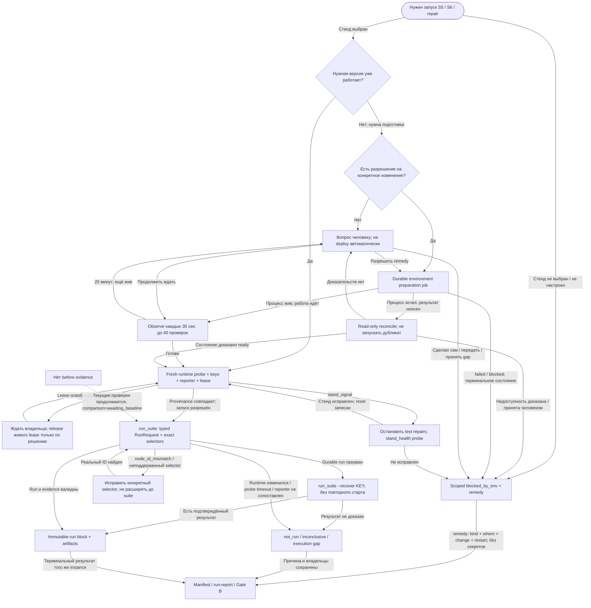

Conductor вправе чинить стенд лишь при `AUTHORIZED` в `environments[].bring_up` или `driver.stand_remedy_authorized=true`; решение stand-gap `apply` открывает только конкретное исправление. Другие ответы — `theirs`, `handed`, `accept` — сами по себе не разрешают изменение стенда. Нет before-снимка ≠ нет возможности проверить after: сравнение остаётся открытым, независимые проверки продолжаются. Поздний терминальный запуск того же instance может вытеснить старый env block; он не отменяет человеческое решение или `pending_implementation`.

Источники: `scripts/story_run.py:environment_job,conductor`, `references/environment-preparation.md`, `skills/qa-story/phases/s5.md`, `skills/qa-story/phases/s6.md`, `design/state-exits.md`.

## 8. S6: что запускается повторно, а что нет

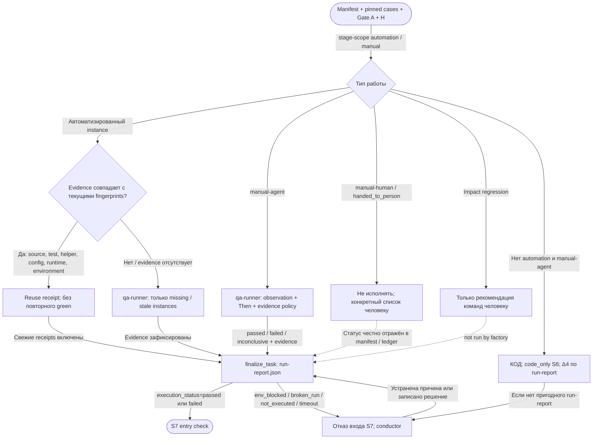

Смена стадии сама по себе не делает зелёное свидетельство устаревшим. Ручной статус `inconclusive` не считается успехом и требует triage. Свидетельство внешнего запуска handed-теста можно позже импортировать через `import_test_receipt.py`; фабрика не ждёт его автоматически.

Источники: `skills/qa-story/phases/s6.md`, `scripts/story_run.py:stage_S6,failures_to_triage`, `references/manual-evidence.md`.

## 9. S7: все классы triage и flaky

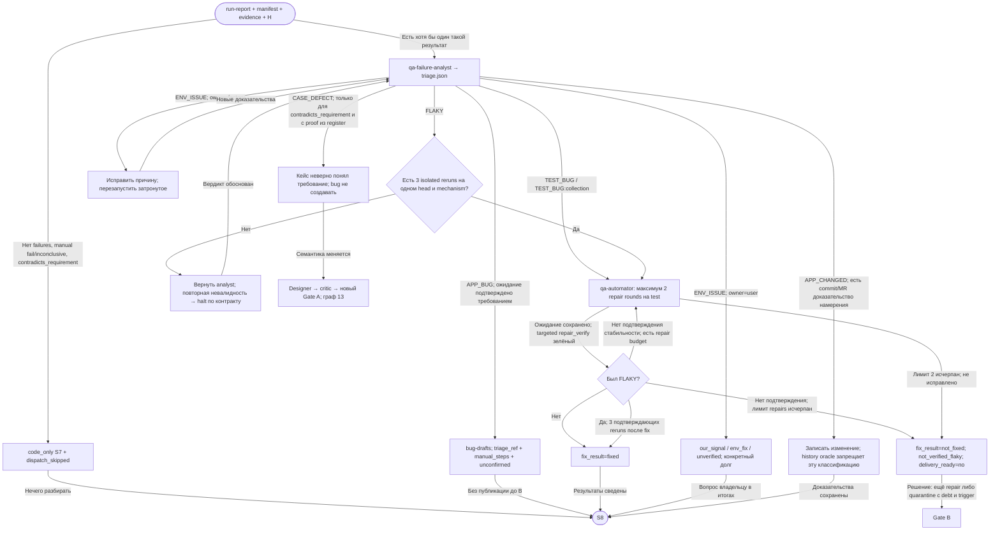

`FLAKY` — не «упал, затем один раз прошёл». Нужны серия и механизм: `isolation`, `race`, `timing`, `shared_state`, `teardown`, `environment` или `unknown`. Карантин не автоматический выход; его разрешает человек на B с файлом долга и условием возврата.

В driver ремонт S7 регистрируется как `rework S5 qa-automator`; успех локального цикла определяется строками digest `green/passed/fixed`. Полноценность flaky-evidence должны обеспечивать роль и валидаторы, не сам этот цикл — Δ6.

Источники: `skills/qa-story/phases/s7.md`, `scripts/story_run.py:stage_S7,s7_repairs`, `handoffs/s7-analyst-to-automator.yaml`, `handoffs/s7-automator-to-analyst.yaml`.

## 10. S8 и Gate B: ledger, качество результата и решение

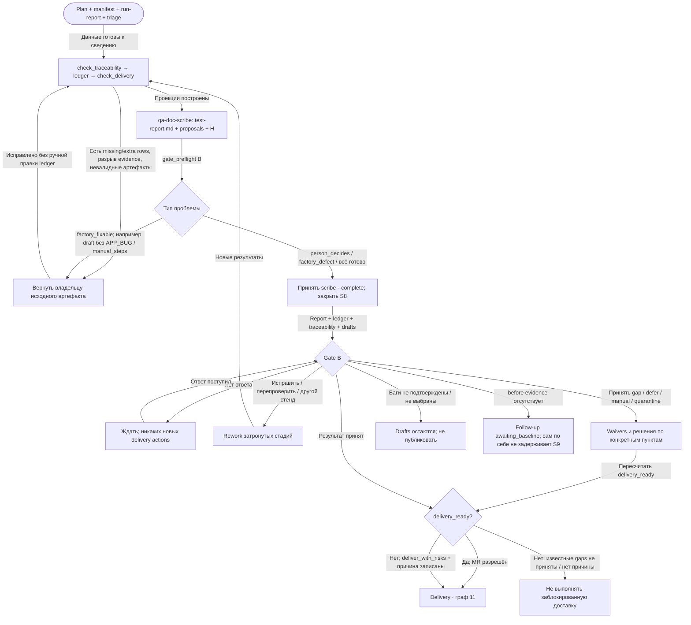

Ledger генерируется кодом: одна строка на plan row и одна на manifest test. `delivery_ready` — консервативная готовность доставки, а не синоним «продукт плохой». `reason_records[].owner` различает `product`, `factory`, `environment`, `review`. Дефекты фабрики должны быть названы как её дефекты; accepted risk и handed tests не превращаются в `passed_green`.

Выбор «не открывать MR» допустим: результат может остаться локальным, а S9 всё равно завершает историю. Подтверждение Gate B не означает, что каждый draft нужно отправить наружу.

Источники: `skills/qa-story/phases/s8.md`, `references/artifact-contract-ledger.md`, `scripts/check_delivery.py`, `handoffs/s8-scribe-to-gate-b.yaml`.

## 11. После B: tracker, MR, внешний канал и S9

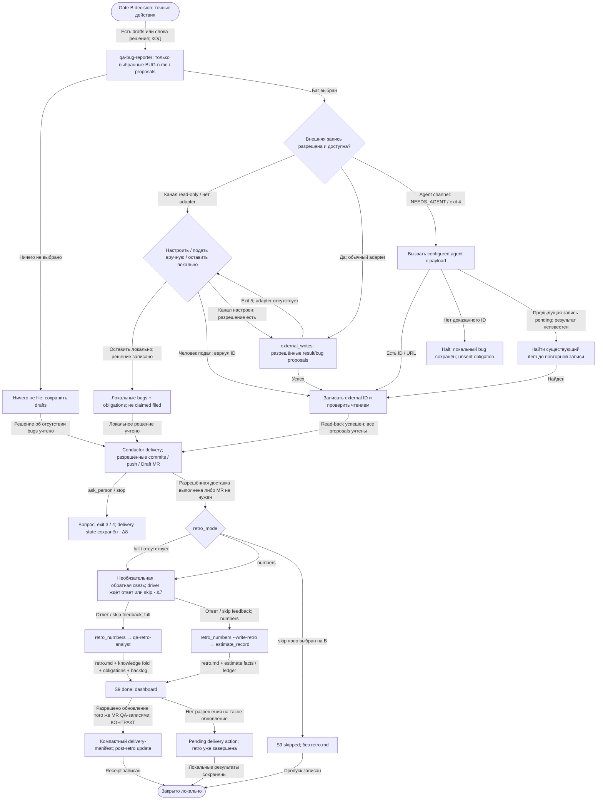

Пути внешней записи на этом графе описаны **контрактом S8**. В текущем driver есть более узкое указание delivery-conductor: **«Jira is never written»**, MR — Draft. Поэтому нельзя обещать Jira-публикацию только потому, что общий контракт разрешает tracker adapter. Код вызывает bug reporter даже при одних словах Gate B без drafts: роль должна сама установить, что filing не заказан.

Компактная доставка: test files из manifest; точные пути `state/delivery-manifest.json`; closing records. Сырые логи, screenshots и `work/evidence/` исключаются. Для прерванной истории контракт отдельно допускает сохранение `work/` ради продолжения. Архивация истории — отдельное решение через doctor, не результат S9.

Источники: `skills/qa-story/phases/s8.md`, `skills/qa-story/phases/s9.md`, `scripts/story_run.py:after_gate_B,delivery,stage_S9`, `handoffs/gate-b-to-delivery.yaml`.

## 12. Сквозной граф: роль умерла, dispatch завис, бюджет, вопрос без ответа

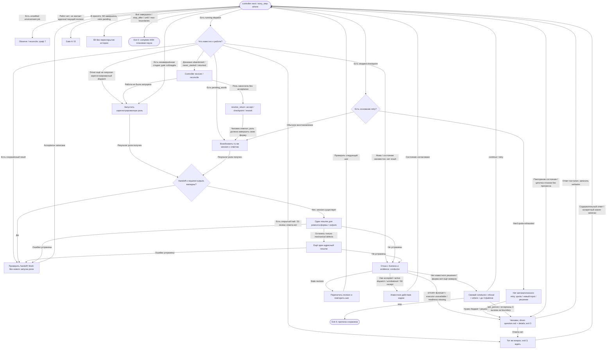

Во время ожидания ответ не подменяется таймаутом. Для нерелевантного ответа контракт S1 различает: меняет scope/oracle/stand → уточнить один раз; не меняет → `remarks[]`, продолжить. Это не равнозначно разрешению любого неотвеченного gate.

На границах есть необязательный judge: без провайдера роли проходят обычные проверки; при настроенном judge появляются source/plan/code/run/results screens и соответствующие `work/judge-*.json`. Для handoff сначала код заполняет выводимые поля (`derived[]`); допустимое сопоставление формулировки judge записывает в `judged[]` с исходными словами. Неустранённая ошибка всё равно идёт по Form → Repair → Conductor. Прочтение ответа человека через `judge_reply` — только подсказка conductor, не запись approval. Для старой истории `handoffs.required=false` отключает обязательность формы; отдельный `finish --ignore-handoff` — исключение с записанным решением, не отсутствие самих рабочих артефактов.

`exit 0` **не гарантирует полное завершение**: он также используется для `--until`, `pipeline.stop_after`, `--max-boundaries`. `exit 3` — нужен человек; `exit 4` — conductor остановился; `exit 1` — ошибка самого driver. В документах лимиты повторения описаны как четыре одинаковых `where` / шесть отказов, но условия кода имеют особенности счётчиков; не следует использовать эти числа как SLA восстановления.

При rollover driver не переносит контекст LLM-оркестратора: он берёт lease и сбрасывает его оконные счётчики, если takeover безопасен. Незавершённые jobs/dispatches/внешние записи сначала надо урегулировать. Story budget при этом не обнуляется.

`unknown_external_writes[]` присутствует в модели takeover, но `design/state-exits.md` прямо указывает, что у поля пока нет writer. Нельзя трактовать его пустоту как доказательство отсутствия неучтённой внешней записи.

Источники: `scripts/controller.py:_next_action_for_state,next_action`, `scripts/story_run.py:run,dispatch_action,handoff,handle_refusal,orchestrator_rollover`, `design/state-exits.md`.

## 13. Изменения после Gate A и восстановление актуальности

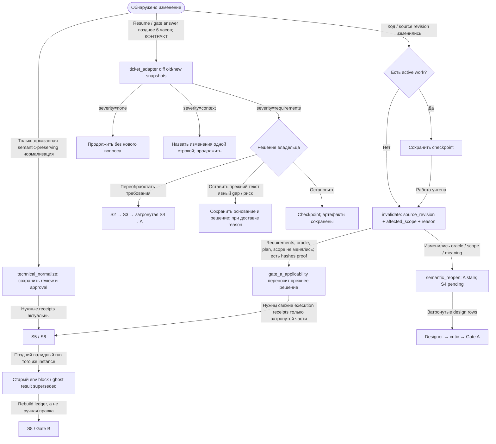

Изменение кода после A не всегда требует повторного A. Но перенос approval требует явного доказательства неизменности смысла и точного scope. Если кейс меняет ожидаемый результат, одного code review S5 недостаточно. Требование проверки свежести тикета через resume/6 часов описано фазами; отдельного прямого вызова `ticket_adapter diff` в основном driver не найдено — Δ9.

Источники: `skills/qa-story/phases/s0.md` §2b, `skills/qa-story/phases/s5.md`, `references/controller-api.md`, `references/stage-model.md`, `design/state-exits.md`.

## 14. Другие входы фабрики: onboarding и doctor

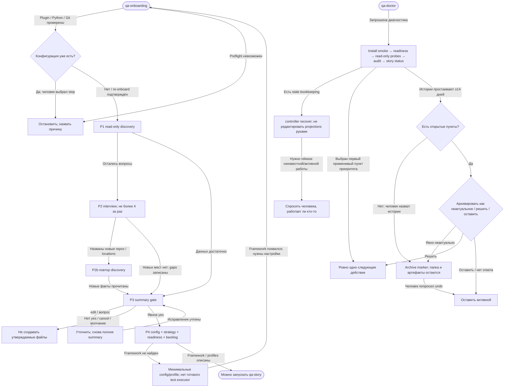

Onboarding approval распространяется на перечисленные файлы и отдельные разрешённые зависимости, не автоматически на commit/push/deploy. Doctor выдаёт диагноз и одно следующее действие, а не начинает новую QA-story. Архив — способ скрыть историю с доски; это не доказательство её прохождения.

Приоритет рекомендации doctor: legacy/незавершённый smoke → install FAIL → не Git repo → нет config → schema → capability владельца-user → unresolved halt → stale closed state → unanswered gate → audit violation → продолжить последнюю открытую story. Factory-owned capability defect показывается как дефект фабрики, а не как поручение человеку исправить доступ.

Источники: `skills/qa-onboarding/SKILL.md`, его `phases/`, `skills/qa-doctor/SKILL.md`, `skills/qa-doctor/phases/archive.md`, `skills/qa-doctor/phases/repair.md`.

## 15. Где документация и driver расходятся

Эти пункты — результаты статического сравнения, не подтверждённые воспроизведением runtime-дефекты. На схемах такие пути помечены, чтобы желаемый процесс не выдавался за гарантированное исполнение.

| Метка | Что написано в контракте | Что делает код этой ревизии | Следствие для графа |
|---|---|---|---|
| Δ1 | S0/S1 не допускают agent как маршрут чтения тикета: нужны оригиналы и связанные источники | `s0()` вызывает `ticket_by_agent()`, если прямое чтение неполно | Есть дополнительная ветка agent → временный ticket file; downstream completeness всё равно надо доказать |
| Δ2 | При отсутствии стендов записываются `environment=null`, `environment_pending=true` | `pending = not no_environments_configured`; для пустого списка получается false | Планирование возможно, но индикатор отложенного выбора отличается |
| Δ3 | В S0 §4 есть стоп на dead/login; §5 называет сбой warning для планирования | Driver однозначно поднимает `Person` при `env_probe exit 1`; ряд warnings фазы не собирает отдельной логикой | Нельзя обещать, что выбранный недоступный стенд позволит пройти S0 |
| Δ4 | Есть manual-agent маршрут S4→S6; не все истории обязаны иметь automate cases | `stage_S5()` отказывает при пустом scope. `stage_S6()` с пустым scope закрывает стадию без создания run-report, а S7 требует passed/failed report | Manual-only / nothing-to-run путь может уйти в общий отказ, а не пройти автоматически |
| Δ5 | Repair cause различает test_defect, mechanical, environment, tooling, reviewer_error | В `stage_S5()` повтор по concerns всегда `cause=test_defect`; до двух repairs после первого review | Второй code-critic reject не всегда конец; особые causes не имеют отдельной прямой развилки этого цикла |
| Δ6 | S7: 3 reruns до/после flaky-fix; analyst владеет triage; CASE_DEFECT возвращает кейс | `s7_repairs()` делает `rework S5`, ориентируется на digest green/passed/fixed, затем finalize; отдельные маршруты ENV/CASE в driver не выделены | Ряд переходов обеспечивается ролью/валидатором/conductor, а не детерминированным driver |
| Δ7 | S9 optional feedback: silence может считаться declined | Driver спрашивает один раз и выходит 3; без `--answer` нет автоматического истечения ожидания | Молчание не завершает retro; `skip` ответа отличается от `retro_mode=skip` |
| Δ8 | Контракт S8 поддерживает tracker channels и post-retro delivery | Driver delivery-prompt запрещает Jira и требует Draft MR; `state.delivery` ставится и при ask_person/stop, а повторный вызов пропускается при его наличии | Нельзя обещать прямую Jira-запись или автоматический повтор прерванной доставки без проверки состояния |
| Δ9 | Resume / ответ через >6ч требуют ticket freshness diff; S9 требует close-gate-b и post-retro allowlist update | В основном driver нет явных вызовов ticket `diff`, `traceability --close-gate-b` и отдельного post-S9 delivery update | Эти контрактные переходы нельзя считать гарантированными самим циклом driver |

Ещё две особенности счётчиков: S4 считает принятые critic-dispatches, S5 хранит `rounds` локально; guard no-progress использует `repeats >= 4` при старте с нуля, а refusal-loop — `attempts > 6`. Поэтому текстовые «четыре» и «шесть» не буквально совпадают с количеством всех наблюдений. Проверки controller/budget действуют дополнительно.

## 16. Все 18 объявленных handoff-контрактов

Каждая строка имеет YAML-шаблон в `handoffs/`. Заполненная dispatch-форма находится в `work/handoffs/<dispatch>.yaml` и содержит `inputs_read`, `scope`/решение, `artifacts`, `claims`, `unresolved`, `blocked`. Это **обёртка передачи**, а сами plan, cases, evidence и ledger остаются отдельными файлами.

| № | Откуда → куда | YAML-контракт | Данные, которые получает следующая сторона |
|---|---|---|---|
| 1 | S0 qa-story → S1 scout | `s0-setup-to-scout.yaml` | `pipeline.json`, config, ticket ref/file, флаги, repo paths, stand, readiness, `project:obligations.md` |
| 2 | S1 scout → S2 tester | `s1-scout-to-tester.yaml` | `context-bundle.json`, `context-manifest.json`, `impl-diff.txt` если применим, `source-inventory.json`, source/material paths; число файлов/hunks/bytes, решения по gaps |
| 3 | S2 tester → S3 strategist | `s2-tester-to-strategist.yaml` | `requirements-register.md`, `requirements-readiness.json`, `understanding.md`, `sizing.json`, учёт прочитанных diff/source материалов |
| 4 | S3 strategist → S4 designer | `s3-strategist-to-designer.yaml` | `test-plan.md`, `work/test-plan.json`, register; dispositions, obligations, manual evidence policy; optional judge-plan |
| 5 | S4 designer → case critic | `s4-designer-to-case-critic.yaml` | Markdown cases в реальном cases_root, plan, register, `state/story-case-links.json`; точные pinned versions |
| 6 | S4 critic → designer / завершение S4 | `s4-case-critic-to-designer.yaml` | `critic-findings.md`, полный roll-call, findings с expected/check, verdict по затронутым IDs |
| 7 | S4 designer → S6 runner | `s4-designer-to-runner.yaml` | Pinned manual-agent cases, шаги, Then, manual evidence policy, plan; передача минует авторство automation S5 |
| 8 | Gate A person → automator | `gate-a-to-automator.yaml` | Дословное решение, scope/hashes/revision, approved cases, plan/context, принятые gaps, действия TMS |
| 9 | S5 automator → code critic | `s5-automator-to-critic.yaml` | Test files, `automation-manifest.json`, case versions, targeted run evidence, Then/obligation bindings, optional s5-notes |
| 10 | S5 code critic → automator / acceptance | `s5-critic-to-automator.yaml` | `work/test-code/critic-findings.md`, cause/expected/check, `work/windows/<dispatch>.json`, review/probe receipt refs |
| 11 | S5 automator → S6 runner | `s5-automator-to-runner.yaml` | Manifest + instances + run receipts + fingerprint/provenance + evidence paths; что reuse, что ещё выполнить |
| 12 | S6 runner → S7 analyst | `s6-runner-to-analyst.yaml` | `run-report.json`, manifest, evidence, plan, runtime provenance; executed/reused/blocked и inconclusive |
| 13 | S7 analyst → automator | `s7-analyst-to-automator.yaml` | `triage.json`, failed instance, verdict, mechanism, evidence paths, допустимый объём ремонта |
| 14 | S7 automator → analyst | `s7-automator-to-analyst.yaml` | Изменённые test files, `repair_verify` witness, сохранённые Then, подтверждение результата |
| 15 | S7 analyst → S8 scribe | `s7-analyst-to-scribe.yaml` | `triage.json`, `bug-drafts/`, актуальный `run-report.json`; что исправлено и что осталось |
| 16 | S8 scribe → Gate B person | `s8-scribe-to-gate-b.yaml` | `test-report.md`, `ledger.json/md`, `traceability.json`, delivery-summary, drafts, решения и открытые пункты |
| 17 | Gate B person → delivery/reporter | `gate-b-to-delivery.yaml` | Выбранные drafts, точные delivery actions, risk reason, `state/delivery-manifest.json`, exclude paths, retro_mode |
| 18 | S9 retro → project | `s9-retro-to-project.yaml` | `retro.md`, `retro-numbers.json`, knowledge updates, `project:obligations.md`, backlog, estimation record |

Дополнительно `role-to-conductor.yaml` — не девятнадцатый линейный этап, а аварийная передача: `work/handoffs/*.help.yaml` с полем, отказом, попытками, candidate value и файлами. Ответ conductor: `fill`, `correct_the_work`, `ask_the_person`, `change_the_contract`; контрактный дефект идёт в backlog.

Происхождение таблицы: весь `handoffs/index.yaml` и соответствующие 18 файлов, а не предположение по названиям ролей.

## 17. Артефакты состояния, которые сопровождают все стадии

| Файл / группа | Назначение и передача |
|---|---|
| `pipeline.json` | Человекочитаемая проекция стадий, gates, halts, waivers/remarks, environment и source mode; не заменяет evidence |
| `state/events.jsonl`, `state/controller.json` | Журнал контроллера и его проекция: dispatches, scopes, revisions, decisions, checkpoints; recover восстанавливает проекции |
| `state/driver-state.json` | Session IDs, pending_words, asked question, retro feedback, delivery marker |
| `state/driver-question.md`, `driver-question-details.md` | Вопрос человеку и отдельная техническая причина остановки |
| `state/driver-answers.jsonl`, `driver-question.answered.md` | Дословные ответы и сохранённый отвеченный вопрос |
| `state/driver-runs/<dispatch>.json`, `driver-runs.jsonl` | Сохранённый result для recovery и журнал запусков с usage/cost |
| `state/conductor.jsonl` | Какие отказы обработаны и какое решение conductor вернул |
| `work/handoffs/<dispatch>.yaml` | Контракт передачи конкретной роли; не заменяет перечисленные в нём файлы |
| `work/evidence/`, immutable run/manual blocks, `work/probes/`, `work/windows/` | Проверяемые свидетельства исполнения/обзора с hashes и identity; разные виды receipts не взаимозаменяемы |
| `state/story-case-links.json` | Связь истории с точными версиями case snapshots, в том числе из общей библиотеки cases_root |
| `work/ledger.json`, `work/ledger.md` | Пересчитываемые проекции manifest + run-report + triage; итог не правят вручную |
| `project:records/journal.jsonl` (в старом проекте — `state/`), `project:state/cost/` | События и стоимость проекта; вход числовой части retro |
| `project:obligations.md` | Перенос открытых обязательств между историями; S0 следующей истории перечисляет подходящие по area/trigger |

## 18. Проверка покрытия примеров из запроса

| Ситуация | Где виден путь | Куда ведёт |
|---|---|---|
| Requirements contradict each other | Граф 4 | blocked → вопрос владельцу → S2 повторно; неразрешённый конфликт не порождает план |
| Requirements incomplete | Граф 4 | blocked при влиянии на смысл; иначе ready с явными gaps и явные вопросы A |
| Requirements contradict code | Графы 3, 6, 9 | До A — решение oracle; после A — red evidence → APP_BUG или доказанный CASE_DEFECT |
| You did not answer a question | Графы 3, 5, 10, 12 | Ожидание; нет неявного approval; remark отдельно от нерешённого существенного вопроса |
| Stand unavailable | Графы 2, 7, 8 | Зависит от точки: S0 driver halt либо planning gap; исполнение scoped blocked/remedy |
| MR not written; cases ahead | Графы 3, 5 | Явный ungrounded → S2–S4 → A → pause; дальнейшая проверка не выдаётся за passed |
| Case critic fails second time | Граф 5 | Долг/reject/partial на Gate A, решение человека |
| Code critic fails second time | Граф 6 | В driver возможен второй repair и третий review; затем unresolved/отказ acceptance |
| Role died / dispatch stuck | Граф 12 | Liveness proof → saved result / recover / checkpoint / relaunch; unknown не равен dead |
| Story budget exhausted | Граф 12 | Вопрос человеку; waiver с решением; hard worker quota отдельно |
| Flaky test | Граф 9 | 3 reruns + mechanism → ≤2 repairs → 3 confirmation reruns либо not_verified_flaky → B |
| Tracker read-only | Графы 2, 11 | Предупреждение; локальные bugs; настроить / file вручную / keep local; особенность Jira driver отмечена |
| Code changed after gate A | Граф 13 | Scoped invalidate; доказанная applicability либо semantic reopen → S4 → A |
| Story too big | Граф 4 | XXL recommendation на A; разделение — решение человека, не автоматический splitter |

## 19. Навигация по первичным источникам

Ссылки фиксированы на исследованную ревизию, поэтому сдвиг ветки не меняет основание анализа.

- [Driver: исполняемые переходы и отказоустойчивость](https://git.example.com/dev1/yml-text-factory/-/blob/b9a35c7040c54a537ba72f1a217787c13ad537f1/ai-packages/qa-factory/scripts/story_run.py)
- [Controller: состояния, scope, approval, next action](https://git.example.com/dev1/yml-text-factory/-/blob/b9a35c7040c54a537ba72f1a217787c13ad537f1/ai-packages/qa-factory/scripts/controller.py)
- [Machine-readable stage model](https://git.example.com/dev1/yml-text-factory/-/blob/b9a35c7040c54a537ba72f1a217787c13ad537f1/ai-packages/qa-factory/references/stages.json)
- [Все 18 передач](https://git.example.com/dev1/yml-text-factory/-/blob/b9a35c7040c54a537ba72f1a217787c13ad537f1/ai-packages/qa-factory/handoffs/index.yaml)
- [Фазы S0–S9](https://git.example.com/dev1/yml-text-factory/-/tree/b9a35c7040c54a537ba72f1a217787c13ad537f1/ai-packages/qa-factory/skills/qa-story/phases)
- [Контракт controller API](https://git.example.com/dev1/yml-text-factory/-/blob/b9a35c7040c54a537ba72f1a217787c13ad537f1/ai-packages/qa-factory/references/controller-api.md)
- [Способы выхода из состояний](https://git.example.com/dev1/yml-text-factory/-/blob/b9a35c7040c54a537ba72f1a217787c13ad537f1/ai-packages/qa-factory/design/state-exits.md)
- [Ledger contract](https://git.example.com/dev1/yml-text-factory/-/blob/b9a35c7040c54a537ba72f1a217787c13ad537f1/ai-packages/qa-factory/references/artifact-contract-ledger.md)
- [Onboarding](https://git.example.com/dev1/yml-text-factory/-/blob/b9a35c7040c54a537ba72f1a217787c13ad537f1/ai-packages/qa-factory/skills/qa-onboarding/SKILL.md)
- [Doctor](https://git.example.com/dev1/yml-text-factory/-/blob/b9a35c7040c54a537ba72f1a217787c13ad537f1/ai-packages/qa-factory/skills/qa-doctor/SKILL.md)
